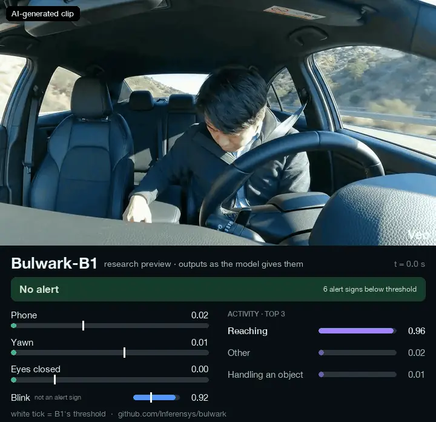

# Bulwark: driver drowsiness and distraction detection
[](https://github.com/Inferensys/bulwark/actions/workflows/ci.yml)

Research video model for driver monitoring systems: eye closure, PERCLOS, blinks, yawns,
phone use, eating, drinking and activity from a 2-second in-cabin clip.

<p align="center">
  
</p>

<sub>AI-generated clip (Google Veo), no real person. Bulwark-B1's unedited outputs from
`bulwark predict`: a phone alert in the 3-5 s window while the driver texts. On other
AI-generated clips from the same camera view it misses yawns, shut eyes and a glance out of
the side window. White tick = B1's threshold; blink is shown but is not an alert sign.</sub>

- **Get the model:** [Bulwark-B1 on Hugging Face](https://huggingface.co/Inferensys/bulwark-b1-driver-monitoring),
  a gated repository that approves access requests automatically. Use B1 for research.
  [Bulwark-E1](https://huggingface.co/Inferensys/bulwark-e1-driver-monitoring-onnx), a
  smaller ONNX model for CPU, is a research preview that scores well below B1.
- **Licence:** the code is Apache-2.0, except Meta's encoder code in
  `bulwark/model/vjepa21` (MIT); the weights are CC BY-NC 4.0 plus the training datasets'
  terms, for non-commercial research only.
- **Commercial use:** not allowed with these weights. For commercially licensed models,
  [contact Inferensys](https://inferensys.com/contact) or write to hello@inferensys.com.

Bulwark is developed by Inferensys. It predicts eye, head and mouth signals, objects such
as phones, alertness and activity, and capture conditions from a short clip, all from one
shared model. The aim is a common base for monitoring drivers, machine operators and
other workers, with each application built as a small adapter plus rules on top; those
applications are not part of this repository.

- **Bulwark-B1** (base, released): Meta's V-JEPA 2.1 ViT-B/16 video encoder, kept frozen,
  with LoRA adapters on the attention and MLP layers (`qkv`, `proj`, `fc1`, `fc2`) of its
  last 4 blocks and its final norm trained, 25 summary tokens and multi-task heads.
  Weights: https://huggingface.co/Inferensys/bulwark-b1-driver-monitoring.
- **Bulwark-E1** (edge, released as a research preview): EfficientViT-B1 per frame plus
  the same kind of heads, distilled from B1 and exported to ONNX for CPU.
  Weights: https://huggingface.co/Inferensys/bulwark-e1-driver-monitoring-onnx. E1 v0, its
  first distillation from B1 v0, scores well below B1. It does not detect closed eyes in
  driver video (chance on DMD), its phone, eating and drinking detection falls to chance
  or below on a camera view it was not trained on, and its activity results are weak. It
  does well on close-up still images of eyes (MRL Eye) and on phone use from the camera
  views it was trained on. Use it to try CPU and ONNX deployment and Bulwark's output
  format, not for its accuracy; use B1 for research. E1 will be retrained with a
  different recipe ([evaluation](docs/evaluation.md#e1-v0-test-results)).

> **Status.** Research code, version 0.1.0. The Bulwark-B1 v0 and Bulwark-E1 v0 weights
> are published on Hugging Face, with indicative results (see [Results](#results)); E1 v0
> is a research preview that scores well below B1. Access to the weights is granted
> automatically to anyone who sends the access request (name, company or affiliation,
> intended use) and accepts the licence and the training datasets' terms. See the
> [CHANGELOG](CHANGELOG.md).

## Try Bulwark-B1

To run Bulwark-B1 on a video of your own:

1. Request access on its [Hugging Face page](https://huggingface.co/Inferensys/bulwark-b1-driver-monitoring).
   Access is granted as soon as you submit the form.
2. Install the code and the Hugging Face command-line tool, and log in with a
   [Hugging Face access token](https://huggingface.co/settings/tokens):

   ```bash
   pip install https://github.com/Inferensys/bulwark/archive/refs/tags/v0.1.0.zip huggingface_hub
   hf auth login
   ```

3. Download the weights and run them on a video, such as `my_clip.mp4`:

   ```bash
   hf download Inferensys/bulwark-b1-driver-monitoring --local-dir bulwark-b1
   bulwark predict bulwark-b1 my_clip.mp4
   ```

`bulwark predict` prints one line per 2-second window, one window every second;
`--out timeline.json` saves every output, the decision thresholds and the rolling
PERCLOS. [Using a trained model](#using-a-trained-model) shows the same in Python. The
weights are for non-commercial research only.

## What it predicts

The full list, with each label's definition, is in
[`bulwark/data/taxonomy.yaml`](bulwark/data/taxonomy.yaml). Each training clip carries
only the labels its dataset (or a teacher model) provides, and the loss skips the rest.

| Head | Labels |
|---|---|
| signals | eye openness, eyes closed, PERCLOS, blink, mouth open, yawn, head yaw/pitch/roll, gaze yaw/pitch, head nod (wrong in v0: ignore it, see below), attention direction, hands on controls |
| objects | phone, phone at ear, food, drink, cigarette, eyeglasses, sunglasses, face mask, seatbelt, helmet, safety vest, gloves |
| state | alertness (alert / low vigilance / drowsy / microsleep), KSS, activity (14 classes) |
| condition | modality (RGB / NIR / thermal), low light, face visible, face occluded, context |

Not every output is trained. No training source supervises gaze yaw and pitch, face
occluded or the thermal modality yet. With the datasets used for v0, hands on controls
and gloves get no labels at all (DMD is ingested from the face camera only, which does
not see the wheel, and SH17 is not ingested), and cigarette, seatbelt, sunglasses, face
mask, helmet and safety vest get only positive labels from the VLM teacher, so a model
cannot learn when they are absent. The v0 training configs also leave out attention
direction and face visible (`mask_labels`), and every training job leaves out, per media
type, labels whose training targets have only one class: with the v0 data, context
(every clip is in a vehicle cabin), alertness on video (DMD's derived alertness is only
ever microsleep), and phone and drink on images (AUC Distracted Driver v2 gives them
positives only). Those outputs are untrained and must be ignored;
each checkpoint lists the outputs it was trained on (`supervised_labels`), and
`bulwark.inference` returns only those by default. Mouth open, head yaw/pitch/roll, head
nod and alertness have no ground truth in v0 training, only teacher or derived labels, so
they are not evaluated. v0's head nod is also wrong: its teacher labels came from a rule
that had the pitch sign reversed. It is among the trained outputs that `bulwark predict`
returns, so ignore it (see the model card's [Limitations](MODEL_CARD.md#limitations)).
Head pitch is positive when the head tips down relative to the camera, so 0 means facing
the camera, not a level head. KSS comes only from UTA-RLDD, the held-out dataset, so it
gets no training labels. Ingesting more datasets (NTHU-DDD, YawDD and SH17 among them)
changes this. The [model card](MODEL_CARD.md#labels-and-supervision) lists the sources of
every label and its status with the data used at the time of writing.

## Licences

| What | Licence |
|---|---|
| Code in this repository | [Apache-2.0](LICENSE), except Meta's V-JEPA 2.1 encoder code vendored in `bulwark/model/vjepa21`, which is [MIT](bulwark/model/vjepa21/LICENSE) (third-party notices in [NOTICE](NOTICE)) |
| Bulwark-B1 v0 and Bulwark-E1 v0 weights | [CC BY-NC 4.0](https://creativecommons.org/licenses/by-nc/4.0/) plus the terms of the training datasets: **non-commercial research use only**. This excludes product demos, pilots and customer evaluations. See the [model card](MODEL_CARD.md). Published on Hugging Face at [Inferensys/bulwark-b1-driver-monitoring](https://huggingface.co/Inferensys/bulwark-b1-driver-monitoring) and [Inferensys/bulwark-e1-driver-monitoring-onnx](https://huggingface.co/Inferensys/bulwark-e1-driver-monitoring-onnx), each gated with automatic approval of access requests. |
| Datasets | Each keeps its own licence; none is redistributed here. See [docs/datasets.md](docs/datasets.md). |

Why the weights are non-commercial: all v0 training data is licensed for research or
non-commercial use only. Every clip in the manifest records its dataset licence and a
`commercial_ok` flag. The commercial-licence track
([docs/training.md](docs/training.md#commercial-licence-track)) trains on commercially
licensed clips only, with its own `*-clean.yaml` configs. Its frozen features come from
the shared `cache.yaml` and are clean by construction, since no Bulwark training is
behind the frozen encoder. The heads, LoRA fine-tune, B1 outputs and distillation steps
each refuse an init checkpoint, features directory or teacher that was not itself trained
that way, with no override. `bulwark export` converts whichever checkpoint it is given
under the research licence and records that checkpoint's provenance, `commercial_only`
included, in the ONNX metadata; it stores a licence that does not restrict use to
non-commercial research only for weights that `bulwark release-check --commercial`
clears. No commercially licensed data is ingested
yet, so that track cannot produce a model today. The filter also covers only Bulwark's
own training data: the V-JEPA 2.1 encoder and E1's EfficientViT-B1 initialisation
(timm's ImageNet-1k weights) were pretrained upstream on data with its own terms, which
need checking before a commercially licensed model is built on them (listed in the model
card). For commercially licensed models, [contact Inferensys](https://inferensys.com/contact)
or write to hello@inferensys.com.

Whether weights may be published at all also depends on each training dataset's terms,
and those of the v0 training sources do not settle it: DMD's terms allow academic use
only and Drive&Act's research use only, MRL Eye states no licence, and none of them, nor
AUC Distracted Driver v2's licence agreement, mentions trained models. On 2026-10-30
Inferensys decided to release the v0 weights for non-commercial research only, under
CC BY-NC 4.0, on each dataset's research terms. That is Inferensys's decision, not a
statement by the datasets' owners; users must also follow each dataset's terms, and if a
dataset's owners object, the weights trained on it are withdrawn and the models retrained
without it. The dataset registry records the decision as `weights_release_ok` with its
`weights_release_basis`; `bulwark release-check <model>` checks a model's training data
against it and prints that basis with its verdict ([RELEASING.md](RELEASING.md)).

## How it works

```
raw datasets ─ingest─▶ per-dataset manifests ─split─▶ manifest.parquet ─shard─▶ tar shards (256 px JPEG)
                                                            ▲                          │
                                          label merge ──────┘◀── teachers (MediaPipe, RF-DETR, Qwen3-VL)

train cache (frozen encoder) ─▶ features ─▶ train heads ─▶ train lora ─▶ B1
B1 ─▶ train cache (B1 outputs) ─▶ train distill ─▶ E1 ─▶ export ─▶ ONNX
```

- v0 is trained on Drive&Act, the DMD face camera, MRL Eye and AUC Distracted Driver
  v2. The Zenodo driver-behaviour images are excluded
  (`SplitPolicy.excluded_datasets`): their data use agreement forbids sharing the data
  with third parties and asks to review publications 30 days before submission.
- Splits are subject-disjoint. Drive&Act uses its official `split_0` drivers; other
  datasets are split by a stable hash of the subject id. AUC Distracted Driver v2 keeps
  its authors' train/test split by driver with one correction (83 camera-1 test images of
  a driver who is also in train are moved to train) and no val split; it
  publishes no driver ids, so shared drivers could be looked for only by image
  similarity ([data card](docs/data-card.md#splits)). Scores follow Bulwark's own clip
  protocol and labels, so they are not comparable with the datasets' published benchmarks
  ([evaluation](docs/evaluation.md#comparability-with-published-results)).
- Two holdouts measure generalisation. Drive&Act's inner-mirror camera is scored only on
  the 3 `split_0` test drivers, so it is a new camera and new drivers; the rest of that
  view is excluded from training and scoring. UTA-RLDD becomes a cross-dataset holdout
  once it is ingested (it is not yet).
- Teacher labels fill gaps in the datasets' own annotations at half the loss weight;
  ground truth always wins, and only ground truth is scored.
- The B1 fine-tune is configured for a 16 GB GPU in fp16
  (`configs/train/lora-kaggle.yaml`, for a Kaggle T4). On Kaggle's two T4s the B1 v0 run
  peaked at about 3.2 GB allocated on the first GPU and took about 3.6 hours for its
  three epochs and validation passes, in one session of 4.2 hours
  ([measured for v0](docs/training.md#measured-for-v0)). On other data or hardware, run
  the same probe ([docs/training.md](docs/training.md#before-a-long-run)) before a long
  run. An A100 path is in `infra/azure`.
- Distillation runs on one 16 GB GPU (`configs/train/distill.yaml`); measured runtimes
  are in [docs/training.md](docs/training.md#measured-for-v0).

Details: [architecture](docs/architecture.md), [training](docs/training.md),
[evaluation](docs/evaluation.md).

## Training data (v0)

A video clip is 16 frames taken at a stride set by a 2-second window: about 1.5 s of
video at 30 fps, and about 1.07 s for Drive&Act's 15 fps Kinect colour view (the
[data card](docs/data-card.md#clips) gives the rule). Frames are letterboxed to 256 px;
a still image is a one-frame clip. Splits never share a person (for AUC Distracted Driver
v2, which has no driver ids, as far as an image-similarity check can tell).

| Dataset | What Bulwark learns from it | Cameras | People | Clips: train / val / test / holdout | Licence | v0 |
|---|---|---|---|---|---|---|
| [Drive&Act](https://www.driveandact.com/) | 34 cabin activities (reading, phone, eating, reaching…) mapped to activity, attention and object labels | 6 near-infrared cabin views + Kinect colour | 15 drivers | 36,732 / 7,908 / 12,231 / 2,032 | research use only | used (official `split_0`; 7,418 mirror-camera clips of the train and val drivers excluded) |
| [DMD](https://dmd.vicomtech.org/) | phone use, texting, drinking, reaching, grooming; gaze region, eye state, blinks, yawns | RGB face camera | 14 | 11,119 / 2,222 / 4,317 / 0 | CC BY-NC-ND 4.0, academic use | used |
| [MRL Eye](https://mrl.cs.vsb.cz/eyedataset.html) | eyes open or closed, glasses, lighting | near-infrared eye crops | 37 | 70,989 / 8,395 / 5,514 / 0 | no licence stated | used |
| [UTA-RLDD](https://sites.google.com/view/utarldd/home) | self-reported alertness and KSS in real drowsy driving | RGB webcams and phones | 60 | held out entirely | no licence stated | cross-dataset drowsiness holdout once ingested |
| [Multi-Class Driver Behavior](https://zenodo.org/records/14908802) | distraction photos | RGB | no person ids | — | data use agreement | excluded |
| [AUC Distracted Driver v2](https://heshameraqi.github.io/distraction_detection) | texting, phone calls, drinking, reaching, grooming and other distractions | RGB still images from two cabin cameras | 44 drivers (no per-image ids) | 12,638 / 0 / 1,840 / 0 | non-commercial, by request; to develop distracted-driver detection | used (its authors' split by driver, corrected; one driver group per side, no val) |

The v0 manifest holds 183,355 clips: 131,478 train, 18,525 val, 23,902 test, 2,032
holdout and the 7,418 excluded mirror-camera clips. Automatic face labels (eye openness,
PERCLOS, head pose) add teacher targets to 34,731 of them; the 3,361 AUC Distracted
Driver v2 images among them get head pose but no eye labels, since its side cameras are
not among those the face teacher's eye labels are kept for. The
[data card](docs/data-card.md) describes how clips and labels are made, and
[docs/datasets.md](docs/datasets.md) lists every dataset with its terms and citation.
Sample frames are not shown here: the source terms restrict republishing images of their
participants.

## Quick start

Python 3.10 or newer. A GPU is recommended for `train cache`; the other steps below run on
a laptop. [uv](https://docs.astral.sh/uv/) installs the exact versions in `uv.lock`:

```bash
git clone https://github.com/Inferensys/bulwark.git && cd bulwark
uv sync --frozen --extra dev --extra export --extra label   # locked versions, into .venv
source .venv/bin/activate
scripts/fetch_pretrained.sh        # V-JEPA 2.1 ViT-B weights, MediaPipe face model, V-JEPA 2 code (pinned) for a parity test
bulwark datasets                   # every known dataset: licence, commercial use, size, adapter, local copy

# One small public dataset (MRL Eye, a 0.34 GB archive). Check its terms in docs/datasets.md first.
# The official server has at times been unreachable; the second URL is the Internet
# Archive's capture of the same file.
MRL=https://mrl.cs.vsb.cz/data/eyedataset/mrlEyes_2018_01.zip
curl -fL --connect-timeout 30 -o /tmp/mrl_eye.zip "$MRL" \
  || curl -fL -o /tmp/mrl_eye.zip "https://web.archive.org/web/20260423044809id_/$MRL"
echo "17ff89928005cb6e63a53fe020e419060279ff59e57555cfa49693fc1865fdfc  /tmp/mrl_eye.zip" | shasum -a 256 -c
mkdir -p data/raw/mrl_eye && unzip -q /tmp/mrl_eye.zip -d data/raw/mrl_eye

bulwark ingest mrl_eye             # data/manifests/mrl_eye.parquet (roots come from configs/data.yaml)
bulwark split                      # data/manifest.parquet with train/val/test
bulwark shard --sample 500         # 500 clips per split, into data/shards-sample
bulwark train cache --config configs/train/cache.yaml --set shards=data/shards-sample \
  --set features=data/features/quickstart --set precision=auto      # fp32 off-GPU; the config's fp16 is for a T4
bulwark train heads --config configs/train/heads.yaml --set features=data/features/quickstart --set out=checkpoints/quickstart
bulwark evaluate --checkpoint checkpoints/quickstart/best.pt --features data/features/quickstart --out runs/quickstart-eval
```

Without uv, `python -m venv .venv`, activate it and `pip install -e ".[dev,export,label]"`
install the same packages without the pinned versions. Add `--extra ops` to `uv sync`
for the Kaggle scripts, the UTA-RLDD download and the Hugging Face release script
(`scripts/hf_release.py`).

This trains heads on frozen features for one dataset, which checks that the pipeline
works; it is not a useful model. The checksum is that of the official archive as the
Internet Archive captured it. The copy used for v0 training (84,898 images) came from a
Kaggle mirror and has the same images as that archive; [docs/datasets.md](docs/datasets.md)
records which mirror and the image fingerprint both share, which `bulwark.data.sources.base.copy_fingerprint` computes for any copy (it hashes the
images by name, so the folder layout does not matter). `bulwark ingest mrl_eye` computes
it for the copy it reads: records of a copy with the v0 fingerprint name that Kaggle
mirror (`meta["source_copy"]`); records of any other copy carry its own fingerprint and
image count instead (`meta["copy_fingerprint"]`, `meta["copy_image_count"]`). The
original authors' terms govern any copy. The full chain (teacher labels, LoRA fine-tune,
distillation, ONNX export) is in [docs/training.md](docs/training.md).

## Using a trained model

```python
from bulwark.inference import load

model = load(
    "bulwark-b1",                                # a release directory (here B1's, downloaded) or its repository id, a checkpoint, or an ONNX graph
    labels=["eyes_closed", "yawn", "activity"],  # optional: a subset of the outputs the model was trained on
)
outputs = model.predict(frames)                  # frames: (T, H, W, 3) or (B, T, H, W, 3) uint8 RGB
```

- **Python:** `bulwark.inference` returns decoded predictions (probabilities, or values in
  each label's range) and embeddings, and can run over a whole video; `bulwark.adapters`
  trains a small task adapter on the embeddings, which is how an application adds its
  own labels and rules. By default `predict` returns the outputs the model records as
  trained (`supervised_labels`, in every checkpoint, release and exported graph); a model
  that records none returns every head, untrained ones included, so pass `labels=`.
  Outputs are uncalibrated unless the model records temperatures (a release or ONNX
  graph built with `--calibration`) or `temperature=` points at the `calibration.json`
  that `bulwark evaluate` wrote for the same weights (one fitted on other weights is
  refused); given temperatures replace recorded ones. Temperatures and thresholds are
  fitted per media type, and `predict` applies those of its input (an image or video;
  `model.temperature_for(...)`, `model.thresholds_for(...)`).
  Every model takes frames letterboxed to 256 x 256 (E1 resizes them to 224 px inside the
  model, in PyTorch and ONNX alike).
  `bulwark predict <model> <video or image> [--calibration <calibration.json>]` prints
  the per-window outputs or saves them (`--out`, with the val-tuned thresholds of the
  input's media type and, when the outputs include `perclos`, a rolling PERCLOS over the
  last 60 s); an image runs as one 1-frame clip (an ONNX graph must be exported with
  `--frames 1`). See
  [docs/inference-and-adapters.md](docs/inference-and-adapters.md) and
  [examples/](examples/README.md).
- **Releases:** `bulwark release <checkpoint> <dir>` (or `examples/make_release.py`)
  writes a release directory: the full weights in `model.safetensors`, a `config.json`
  with the advertised labels, the weights licence, `commercial_only`, the training
  provenance (names and hashes, no local paths) and the release check, and for B1 Meta's
  V-JEPA licence notice as `LICENSE-vjepa2`, since a B1 release contains weights derived
  from the V-JEPA 2.1 encoder. `bulwark release-check` says whether the weights may be
  published.
- **ONNX:** E1 takes 16 RGB uint8 frames, letterboxed to 256 x 256, and returns one raw
  logit tensor per label in taxonomy order, then the `tokens` and `state` embeddings
  that adapters read (`bulwark export --no-embeddings` leaves them out; `--frames 1`
  exports a graph for still images). The full contract and a decoding example are in
  [docs/architecture.md](docs/architecture.md#e1-onnx-contract); the file's metadata
  stores the contract, the weights licence, a link to the model card, the training
  record, the trained and masked outputs, and with `--calibration` the val-fitted
  temperatures and thresholds of the graph's media type (video, or image for
  `--frames 1`; `bulwark.export.onnx.read_contract`).

v0 weights are for non-commercial research only, and that includes using them to compute
embeddings or to train adapters.

## Results

B1 v0 and E1 v0 are evaluated on the test splits and on the Drive&Act inner-mirror
holdout. Every result is indicative: each dataset's test split holds 3 subjects (AUC
Distracted Driver v2's, one driver group), too few for confidence intervals. On the inner-mirror camera, held out from training, B1 v0 scores AUROC 0.845 for phone at the
ear, 0.808 for phone, 0.911 for food and 0.911 for drink, and activity macro-F1 0.290.
Against the first full run, trained without AUC Distracted Driver v2, its DMD activity
macro-F1 falls from 0.701 to 0.586. The tables, with clip and subject counts, and where
each number comes from are in [docs/evaluation.md](docs/evaluation.md#results). The
generated report (`report.html`, `metrics.json`) is in the `evaluation/b1/` folder of the
[B1 repository on Hugging Face](https://huggingface.co/Inferensys/bulwark-b1-driver-monitoring),
whose files open once access is granted.

E1 v0 scores well below B1 v0 on most outputs. On DMD's driver video its `eyes_closed`
AUROC is 0.497, chance level, against B1 v0's 0.902; on the inner-mirror camera its
AUROC is 0.547 for phone, 0.501 for phone at the ear, 0.495 for food and 0.404 for drink,
and its activity macro-F1 0.085. On test, its activity macro-F1 is 0.227 on Drive&Act,
0.283 on DMD and 0.284 on AUC Distracted Driver v2. On MRL Eye's still eye images it
matches B1 v0 (`eyes_closed` AUROC 0.998), and on the camera views it was trained on its
phone AUROC is 0.905 on DMD and 0.850 on Drive&Act, where each moment's score is the mean
of several cameras' probabilities (0.729 with each clip scored on its own, from one camera,
as on the inner-mirror holdout). The tables are in
[docs/evaluation.md](docs/evaluation.md#e1-v0-test-results), and E1's report is in
`evaluation/e1/` of the
[E1 repository on Hugging Face](https://huggingface.co/Inferensys/bulwark-e1-driver-monitoring-onnx).

## Intended use and limitations

Bulwark is a research base model. Its outputs are signals for decision support, not a
certified safety component, a type-approved vehicle system or a medical device. It must
not be used for employment or disciplinary decisions about individuals, to identify
people, to infer emotions, or for covert monitoring. In the EU, products built on it for
monitoring workers or patients may fall under the AI Act's high-risk rules, its
workplace emotion-recognition ban, GDPR or medical-device law.

v0 data has few subjects, is mostly in-car and near-infrared and has no thermal footage.
Apart from a gender code in MRL Eye's file names, it records no demographic attributes,
so per-group performance on video cannot be measured yet. In research, check results on
your own population and cameras. The [model card](MODEL_CARD.md) covers
intended and out-of-scope uses, regulatory context, limitations and responsible use.

## Documentation

| Document | Contents |
|---|---|
| [MODEL_CARD.md](MODEL_CARD.md) | models, weights licence, training data, label coverage, limitations, intended use |
| [docs/data-card.md](docs/data-card.md) | the v0 training data: sources, clips and splits, labels and teachers, privacy and removal requests, release decisions |
| [docs/architecture.md](docs/architecture.md) | B1 and E1 design, losses, teacher labels, ONNX input/output contract |
| [docs/training.md](docs/training.md) | reproducing the training chain; Kaggle and Azure runs; commercial-licence track |
| [docs/evaluation.md](docs/evaluation.md) | splits, holdouts, metrics and what a score means |
| [docs/datasets.md](docs/datasets.md) | every dataset: licence, commercial use, access, citation |
| [docs/inference-and-adapters.md](docs/inference-and-adapters.md), [examples/](examples/README.md) | Python inference API, task adapters, releases, example scripts |
| [docs/references.md](docs/references.md) | citations for upstream models and methods |
| [CONTRIBUTING.md](CONTRIBUTING.md), [SECURITY.md](SECURITY.md), [RELEASING.md](RELEASING.md), [CHANGELOG.md](CHANGELOG.md) | project process |

## Versioning

The package version (0.1.0, `bulwark.__version__`) versions the code. A model release
(v0) is the set of models trained on the v0 data; Bulwark-B1 v0 and Bulwark-E1 v0 are
released, E1 v0 as a research preview, and E1 will be retrained. The label taxonomy has
its own version (1), because
changing labels changes the model outputs. The split salt (`bulwark-v1`) fixes which
people are in which split and is never changed; a person keeps their split as long as
their dataset's own list of subjects does not change. Each checkpoint records the
config, data filters, a manifest hash, the split salt, the taxonomy version, the package
version, the code version of every training session, the outputs it was trained on, the
datasets of every model it was trained from (`upstream_datasets`), and the Python,
PyTorch, CUDA and other library versions.

## Datasets, models and acknowledgements

Bulwark is trained on public research datasets, each under its own licence and terms;
none is redistributed here. [docs/datasets.md](docs/datasets.md) lists every dataset
with its licence and the terms relied on, and its [citations](docs/datasets.md#citations)
section gives the citation each dataset asks for. Cite every dataset a model you use was
trained on.

Upstream models, each under its own licence (details in [NOTICE](NOTICE)):

| Model | Used for | Licence |
|---|---|---|
| V-JEPA 2 code and V-JEPA 2.1 ViT-B/16 weights (Meta) | B1 encoder | MIT, Copyright (c) Meta Platforms, Inc. and affiliates |
| EfficientViT-B1 (MIT Han Lab), weights through timm | E1 backbone initialisation | Apache-2.0 |
| MediaPipe Face Landmarker (Google) | face teacher labels | Apache-2.0 |
| RF-DETR (Roboflow) | object teacher labels (optional) | Apache-2.0 |
| Qwen3-VL-4B-Instruct (Qwen team) | VLM teacher labels (optional) | Apache-2.0 |
| Wan2.2-TI2V-5B (Wan-AI) | synthetic clips (optional) | Apache-2.0 |

We thank the authors of these models and datasets. Citations for the models and methods
are in [docs/references.md](docs/references.md).

To cite Bulwark, use [CITATION.cff](CITATION.cff) ("Cite this repository" on GitHub).
